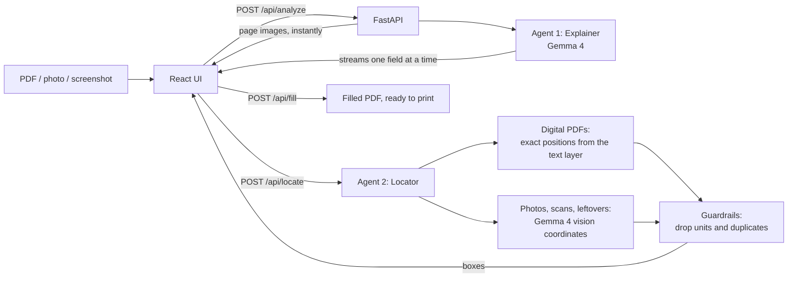

# DocPal

**Any form. Plain words. Done right.**

DocPal helps anyone get through a confusing form: immigration, admission, scholarship, banking, medical, government or employment. Upload a PDF, photo or screenshot of the form. Gemma 4 explains every field in simple words, in English or Urdu, and tells you exactly what you need to have ready. You type your answers next to each explanation, see them appear on the form as you type, and download a clean, filled PDF ready to print or submit.

**The AI never fills in answers for you.** It explains what each field asks for and what you need, and you write the answers. Every explanation also quotes the exact text it read from the form, so you can check it.

## Features

- **Any form, any domain.** Nothing is hard-coded per form. Gemma reads the whole document and works out its fields.
- **Plain-language explanations.** Short sentences, everyday words, and jargon such as "attested" or "CNIC" explained. Available in English and Urdu, with Urdu shown right to left.
- **"You need" lists.** Each field shows the documents or facts you must have ready, never made-up values.
- **Warnings and checklist.** Deadlines, penalties, required signatures and attachments become short alerts, plus a step-by-step checklist you can tick off and copy.
- **Click to highlight.** Click a field on the form to jump to its explanation, or click an explanation to highlight its spot on the form.
- **Every kind of field.** Lines, empty boxes (beside or under the label), letter-by-letter boxes (one character per box), checkboxes, Yes / No and "tick all that apply" lists. Choice fields show tick boxes or radio buttons, and the download gets a tick mark in the right box.
- **Fill and download.** Your answers are written onto the page as normal text, so the download looks finished in every PDF viewer and prints clean. To change an answer, edit it in DocPal and download again. Photos and screenshots are turned into PDFs too.
- **Fast first results.** The form preview appears instantly and the first explanation shows up within seconds, because results stream in one field at a time.
- **Private.** Files are processed in memory and never written to disk or stored.
- **Open weights.** Runs on Gemma 4 through the Gemini API, or fully locally through Ollama.

## How it works

DocPal uses two Gemma 4 agents one after the other: the first explains the fields, the second finds where each answer goes on the page.



**Agent 1, the Explainer.** Gemma 4 reads every page image and writes one line of JSON per field: the label, the text it was read from, a plain-language explanation, what you need, whether the field is required or already filled, and whether it's a text field or a choice (with its printed options). The backend validates each line and streams it straight to the browser, so field cards appear while Gemma is still writing.

**Agent 2, the Locator.** Once all fields are in, the Locator works out where each answer goes:

1. **Digital PDFs:** it searches the PDF's own text for each field's label, then takes the nearest blank to its right: a line, an underscore run, a form box, an empty drawn box or a row of letter boxes. Boxes and letter rows just under the label count too. For choice fields it finds each printed option near the label and the small square beside it (or the spot just left of the text when there is none). This is exact and takes about a second.
2. **Photos, scans and anything the text search missed:** Gemma 4 returns a box for each field's answer area.
3. **Guardrails** then remove things that aren't real fields: units printed after a blank (such as "Per Month") and any second field that points at the same blank.

**Filling.** DocPal writes each answer into the located spot (into the existing form box, if the PDF has one), then flattens everything into normal page text.

## Tech stack

| Layer | Technology |
|---|---|
| AI model | Gemma 4 (`gemma-4-26b-a4b-it`) via the Gemini API, or Ollama for local open weights |
| Backend | Python 3.12, FastAPI, Pydantic v2, PyMuPDF, google-genai |
| Frontend | React 18, Vite, Radix Themes (indigo / slate), Radix Icons, Geist font |
| Serving | Docker Compose, nginx (serves the frontend and forwards `/api` to the backend) |

## Quick start (Docker)

You need Docker Desktop and a free Gemini API key from [Google AI Studio](https://aistudio.google.com/apikey).

```bash
cp backend/.env.example backend/.env    # then put your key in GEMINI_API_KEY
docker compose up --build
```

- App: http://localhost:3000
- API docs: http://localhost:8000/docs

After changing code, run `docker compose up -d --build` again. The containers don't pick up code changes automatically. Changes to `backend/.env` only need `docker compose up -d`.

Try it with the sample forms in [samples/](samples/). `sample_visa_form.pdf` has every field type: lines, a box, letter boxes, checkboxes and Yes / No.

## Local development

Both servers reload automatically when you save. Stop Docker first (`docker compose down`), because both setups use port 8000.

**Backend** (http://localhost:8000):

```bash
cd backend
python -m venv .venv
.venv\Scripts\activate            # macOS/Linux: source .venv/bin/activate
pip install -r requirements.txt
cp .env.example .env              # add GEMINI_API_KEY
uvicorn app.main:app --reload
```

**Frontend** (http://localhost:5173, forwards `/api` to the backend):

```bash
cd frontend
npm install
npm run dev
```

**Tests:**

```bash
cd backend
python -m pytest
```

## Configuration

All settings live in `backend/.env`. See [backend/.env.example](backend/.env.example).

| Variable | Default | What it does |
|---|---|---|
| `PROVIDER` | `gemini` | `gemini` uses the Gemini API; `ollama` uses a local model |
| `GEMINI_API_KEY` | | Your key from Google AI Studio (Gemini only) |
| `GEMMA_MODEL` | `gemma-4-26b-a4b-it` | Model id, without the `models/` prefix |
| `GEMMA_THINKING` | `minimal` | Lowers Gemma's thinking time, which makes it about 4x faster on the 26B model. Leave it empty for models that reject it, such as `gemma-4-31b-it` |
| `OLLAMA_URL` | `http://localhost:11434` | Ollama server (Ollama only) |
| `RATE_LIMIT` | `5` | How many forms each visitor (by IP address) can analyze per 5 minutes. Extra requests get a friendly "try again in N min" message |
| `CORS_ORIGINS` | `http://localhost:5173` | Allowed browser origins, comma separated. Only needed when frontend and backend are on different domains |

To list the Gemma models your key can use:

```bash
python -c "from dotenv import load_dotenv; load_dotenv(); from google import genai; c = genai.Client(); [print(m.name) for m in c.models.list() if 'gemma' in m.name]"
```

**Running fully on open weights** (no API key):

```bash
ollama pull <gemma4-tag>
# backend/.env: PROVIDER=ollama and GEMMA_MODEL=<gemma4-tag>
```

The frontend reads one optional variable: `VITE_API_URL`, the backend's URL, for production builds served from a different domain. Leave it empty when nginx or Vite forwards `/api`.

## API

All endpoints take `multipart/form-data`. Uploads may be PDF, PNG, JPEG or WebP, up to 8 MB; PDFs may have up to 10 pages.

| Endpoint | Input | Output |
|---|---|---|
| `GET /api/health` | | `{"ok": true}` |
| `POST /api/analyze` | `file`, `language` (`English` or `Urdu`) | NDJSON stream of events: `pages` (page images as data URLs), `form` (title, purpose), one `field` per field (with an `id`), `summary` (checklist, warnings), or `error` |
| `POST /api/locate` | `file`, `fields` (JSON list of `{id, label, evidence, kind, options}`) | `{"locations": [{id, page, box, label_box, cells, choices}], "not_fields": [id]}`. Boxes are `[x0, y0, x1, y1]` as fractions of the page size. `cells` holds letter boxes; `choices` maps each option to its tick box |
| `POST /api/fill` | `file`, `values` (JSON list of `{page, box, value, cells}`, or `{page, box, tick: true}` per picked option) | The filled PDF as a download |

The server keeps no state between calls, so the browser sends the file again with each request.

## Project structure

```
backend/
  app/
    main.py        FastAPI routes, upload checks, streaming
    gemma.py       Both agents: prompts, Gemini/Ollama calls, stream and box parsing
    pdf.py         PDF rendering, text-layer field location, guardrails, filling
    schemas.py     Pydantic models for agent output and API payloads
  tests/           pytest suite (stream parsing, boxes, location, guardrails, filling)
  Dockerfile
frontend/
  src/
    App.jsx        Page layout and the analyze, locate, fill flow
    api.js         API calls, including the NDJSON stream reader
    components/    Upload, FormPreview (highlights), FieldList, Checklist
    index.css      Layout and overlay styles on Radix Themes tokens
  nginx.conf       Serves the build and forwards /api to the backend
  Dockerfile
samples/           Example forms for testing and demos
docker-compose.yml
```

## Deployment (DigitalOcean)

**Option 1: App Platform**

- **Backend:** Python service, source directory `backend`. Run command: `uvicorn app.main:app --host 0.0.0.0 --port $PORT`. Set the environment variables from `.env.example`, with `CORS_ORIGINS` set to the frontend URL.
- **Frontend:** static site, source directory `frontend`. Build command: `npm run build`; output directory: `dist`. Set `VITE_API_URL` to the backend URL.

**Option 2: Droplet with Docker.** Copy the repo, create `backend/.env`, and run `docker compose up -d --build`.

Analysis can take up to a minute, so if you put another proxy in front, give it a timeout of at least 300 seconds and turn off response buffering, so the stream reaches the browser as it arrives.

## Limitations

- **Gemma speed varies.** Agent 1 usually finishes a one-page form in 50 to 90 seconds, depending on load on Google's side.
- **Photos and scans are less precise.** Their positions come from Gemma's vision coordinates, so an answer can occasionally overlap a label or land one line off. Digital PDFs use exact text positions.
- **Urdu answers in the PDF.** The downloaded PDF uses a built-in Latin font, so Urdu typed into the answer boxes may not display correctly.
- **Rotated PDF pages** aren't handled; their highlights would be in the wrong place.

## License

[MIT](LICENSE)
